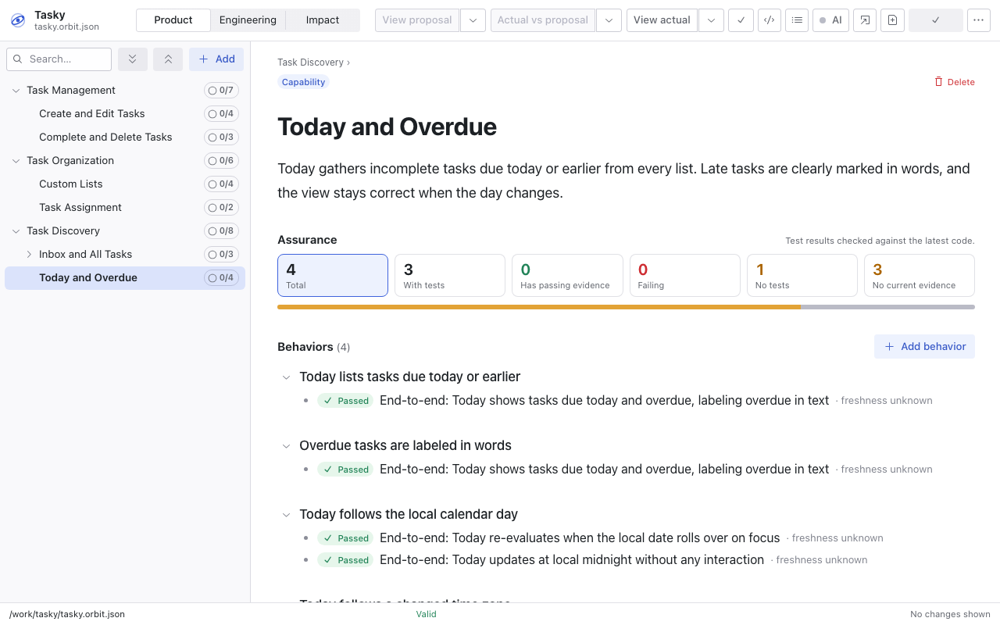

# Orbit

**Orbit** is a local-first desktop app for modeling, visualizing, and comparing what a software product does.
You open one JSON **product contract** that describes the product's user-facing **capabilities**, its internal
**systems**, the **behaviors** each one guarantees, typed **relationships** between them, and the automated **tests**
that verify each behavior. Orbit gives you these perspectives on that file:

| View | For | What you see |
|---|---|---|
| **Product** | product owners | capability tree, behaviors, assurance rollups, focused relationship graph |
| **System** | engineering leads | system tree, behaviors, assurance, and a zoomable **Topology** map (what depends on what) |
| **Flows** | everyone | sequence-diagram walkthroughs of how a capability works (what happens, in what order), listed under their capabilities |
| **Impact** | everyone | what changed (Plan, Plan vs. Actual, Actual), the *potential* downstream impact, and whether each changed behavior is tested and passing |

**Validate** runs the product's whole test suite in the terminal's Validate tab with one command you confirm (default `npm run build`), then reads the JUnit XML
results it writes. The latest matching result determines **Passing** or **Failing**. Missing or skipped results are
**Unconfirmed**. Orbit re-reads the results file when it changes.

Orbit edits the product contract directly with conflict-safe saves and compares local Git revisions without writing Git.
`orbit.plan.json`, next to the contract (e.g. `orbit.json`), holds the pinned baseline and the planned contract. Orbit marks additions
as **Planned** in the Plan view. There is no approval step. Actual comes from the saved product contract.

**Tasky** (`apps/tasky`) is a small, real personal task manager in the same repo. It's the reference product: its
contract is [`examples/tasky.orbit.json`](examples/tasky.orbit.json), and **Validate** runs its real
Vitest and Playwright suites (`npm run validate -w @orbit/tasky`) to fill in every test status.

Orbit also has a built-in **MCP server**, so AI agents can do everything a user can in the running app. See
[AI access (MCP)](#ai-access-mcp).



## Repository layout

```text
apps/orbit/            Orbit desktop app: Tauri 2 (Rust backend in src-tauri/) + React + Radix UI
apps/tasky/            Tasky reference app (Vite + React, localStorage)
packages/contract/     @orbit/contract: types, JSON Schema, validation, semantic diff, graph/impact, assurance
examples/              tasky.orbit.json (main fixture), invalid.orbit.json (diagnostics demo), demo/ snapshots
scripts/               validate-contract, create-demo-repo, orbit-mcp-stdio
tests/                 cross-package integration tests (fixture, impact demo)
docs/                  ORBIT_SPEC.md, visual reference, screenshots
```

## Prerequisites

- **Node.js 20+** (developed on Node 24) and npm
- **Rust** (stable, 1.77+) with Cargo, plus your OS's [Tauri prerequisites](https://v2.tauri.app/start/prerequisites/)
  (Xcode Command Line Tools on macOS; WebView2 + MSVC build tools on Windows; webkit2gtk etc. on Linux)
- **Git** (optional: needed only for comparisons and the impact demo)

Orbit’s project editing works offline. Skill update checks use the official release endpoint, when configured.

```bash
npm install
npx playwright install chromium   # only for the end-to-end tests
```

## Run

```bash
npm run orbit                                   # Orbit desktop app (tauri dev; first run compiles Rust)
ORBIT_FILE="$PWD/examples/tasky.orbit.json" npm run orbit   # open a file directly at launch
npm run orbit:build                             # release build + installer bundle (apps/orbit/src-tauri/target/release)
npm run tasky                                   # Tasky at http://localhost:5174
```

In Orbit: **Open contract…** → `examples/tasky.orbit.json`. Try the Product and System trees, select an entity,
edit behaviors, open **Tests**, click **Validate**, toggle **Raw JSON**, and pick an **Impact** view.

**Create new contract** suggests `orbit.json` when you choose where to save the project.

## Test and verify

```bash
npm run typecheck        # TypeScript across all workspaces
npm run lint             # ESLint
npm test                 # unit tests: contract, Orbit (Vitest + cargo test), Tasky, integration
npm run test:e2e         # Playwright: Orbit UI (in-memory host) and Tasky
npm run validate         # validate examples/tasky.orbit.json (or: npm run validate -- path/to/file.json)
npm run test:mcp         # live: launches the real Orbit app and drives it over MCP (build first, see below)
```

`npm run test:mcp` needs a debug build: `cd apps/orbit && npx tauri build --debug --no-bundle`. It creates a
throwaway demo repo, launches the native app on it, and uses the official MCP SDK client (over HTTP and the stdio
bridge) to open, compare, edit, save, hit a save conflict, reload, and navigate. It then checks that `.git` is
byte-identical.

`cargo test` (run by `npm test`) includes a mechanical **read-only Git** test (AC-13). It hashes every file under
`.git` and the worktree before and after running every Git operation Orbit uses, and asserts they're byte-identical.

## Impact demo (repeatable)

```bash
npm run demo:impact                 # creates a throwaway Git repo in your temp dir and prints its path
npm run demo:impact -- --dir /tmp/orbit-demo
```

The script never touches this repository. It builds a temp repo from `examples/demo/*.orbit.json`:

- `main`: the base contract, plus a reformat-only commit (**0 semantic changes**).
- `proposal`: adds "Overdue items remain visible in Today" plus a test mapping and a relationship.
- `implementation`:
  - adds a notes-editing behavior and test, and changes *Local Date Evaluation*;
  - removes *Complete and Delete Tasks*.
- an uncommitted edit, so `HEAD → Working tree` has a diff.

Open `<printed path>/tasky.orbit.json` in Orbit → under **Impact** choose **Actual**. You should see:

- **Directly changed:** Complete and Delete Tasks, Create and Edit Tasks, Local Date Evaluation
- **Potentially affected:**
  - Today and Overdue (*dependsOn* Create and Edit Tasks)
  - Task Filtering and Sorting (*uses* Local Date Evaluation)
  - Inbox and All Tasks, two hops away (*uses* Task Filtering and Sorting → *uses* Local Date Evaluation)

`tests/demo.test.ts` asserts all of this.

## The contract format

- Schema: [`packages/contract/schema/orbit.schema.json`](packages/contract/schema/orbit.schema.json) (JSON Schema 2020-12).
- Rules: [`docs/ORBIT_SPEC.md` §4](docs/ORBIT_SPEC.md).

In short:

- The top level has `schemaVersion: 1` plus `product`, `entities`, `relationships`, `tests`, and optional
  `flows` and `validation` (`command` + `results`) that says how to run the test suite.
- Older contracts may contain `placeholder: true`. Orbit ignores these entries for Actual coverage. New planned tests belong in the plan file.
- Entities are flat, with `parentId`. Each has `kind` `capability` or `system`, and parents must be the same kind.
- Behaviors live inside their owning entity and have globally unique ids.
- Relationships are `dependsOn`, `uses`, or `implementedBy`, read source → target.
- Flows are optional named walkthroughs of a capability: an ordered list of steps, each along an existing relationship (a step may be a `reply`, travelling target → source). Flows add narrative to existing links and never invent new ones.
- IDs are stable and opaque. Array order carries no meaning, except the order of steps within a flow.

**For external tools and AI agents editing files directly:** edit the JSON with any tool, then validate:

```bash
npm run validate -- path/to/product.orbit.json        # human-readable, exit code 1 on errors
npm run validate -- path/to/product.orbit.json --json # machine-readable diagnostics
```

Or validate from code:

```js
import { parseContract } from '@orbit/contract/dist'; // after: npm run build -w @orbit/contract
```

`parseContract(text)` returns diagnostics with JSON pointers and line/column.

### Test results

Test results are never stored in the contract. **Validate** runs `validation.command` from the repository
root (or the contract's folder outside Git) and reads every JUnit XML file in `validation.results` (default `reports/`). Each result is matched
to a contract test by a `[<test id>]` tag in the test's name when present (Tasky's tests use these), else by the test's
`location` (`<file> › <describe> › <title>`).

- **Passing / Failing:** the latest matching result.
- **Unconfirmed:** no matching result or a skipped test.
- **Planned:** an added test in the Plan comparison.
- A behavior is **Passing** only when all its real tests pass, and **Failing** when any fails.

### Test walkthroughs

Expand a behavior and select the name of a recorded test. Use **Previous** and **Next**, or the left and right arrow keys. The Tasky example records the create and edit task flows when you run `npm run validate -w @orbit/tasky`.

Describe the user action in a standard Playwright `test.step()` title. Orbit lists the assertions recorded in that step under **Expectations**. Playwright's optional assertion message supplies the display text, for example `expect(task, 'The task appears in Work.').toBeVisible()`. Unnamed assertions display Playwright's generated matcher title. To include a screenshot, attach it after the step's assertions with `await step.attach('Form after saving', { body: await page.screenshot(), contentType: 'image/png' })`.

Use Playwright's built-in **Blob** and **JUnit** reporters. For example, configure `['junit', { outputFile: 'reports/e2e.junit.xml' }]` and `['blob', { outputDir: 'reports/blob-report' }]`, and point Orbit at `reports/`. Orbit also looks in Playwright's default `blob-report/` directory under the validation working directory. It matches passing tests by their file and title in `orbit.json` and also recognizes existing Orbit ID tags. Existing HTML reports still work with their original `Expected:` convention.

Other runners can write the same `orbit.walkthroughs.json` file in that folder. The `tests` keys are the test IDs from `orbit.json`. Each step has an optional `description` and an optional `image` pointing to a PNG, JPEG, or WebP under `walkthroughs/`.

```json
{
  "version": 1,
  "tests": {
    "test.tasks.create": {
      "steps": [
        { "description": "Open the new-task form." },
        { "image": "walkthroughs/form.png" },
        { "description": "The new task appears in Work.", "image": "walkthroughs/work.png" }
      ]
    }
  }
}
```

Orbit asks you to approve the exact command before it first runs it, and again whenever it changes (the command comes
from the contract file, which could come from someone else's branch). The command runs in its own process group, and
**Cancel** stops it and everything it started.

## Plan and sync a change

1. Open your project in Orbit and enable its MCP connection in Claude Code.
2. Use **Install Skills** when creating a project or **File → Install/Update Skills** for an existing one. Orbit installs
   the commands in the project's `.claude/skills/` folder. You can commit them to share the installed versions.
3. Run `/orbit-plan` with the work description, spec, or issue. Review `orbit.plan.json` in the **Plan** view
   and iterate on it with `/orbit-plan` until it's right. The baseline stays fixed until you explicitly replace the plan.
4. Run `/orbit-implement` to turn the plan into a detailed implementation plan; once you approve it, the agent builds it and offers to run `/orbit-sync`. Or implement and commit your tickets yourself. Run `/orbit-sync` to reconcile the saved Actual contract and mark the reviewed
   commit with `orbit/sync/<branch>`. **Plan vs. Actual** compares `orbit.plan.json` with Actual. **Actual** uses the pinned baseline.

To require sync for PRs, copy [the workflow template](.github/workflow-templates/orbit-sync.yml) into the consuming
repository's `.github/workflows/` directory and require its **Orbit Sync** check on the protected branch. Push the branch
and the tag to the PR head repository. If only the tag changed, rerun the existing PR check. Enable the up-to-date
branch requirement if the sync must include the latest changes to the target branch. This template compares the PR head
and is intended for the ordinary PR merge flow.

### Publish skill updates

Install / Update Skills reads its release from the `main` branch of
[tylermurry/orbit](https://github.com/tylermurry/orbit): the app fetches `skills/manifest.json` (and the skill files it
lists, each checked against its SHA-256) from `raw.githubusercontent.com`. If that is unreachable it uses the skills
bundled in the app. After changing anything under `skills/claude/`, regenerate the manifest and commit it with the change:

```sh
node scripts/skills-manifest.mjs
```

The release number goes up by one only when a skill's text changed, and CI fails when the manifest is stale
(`node scripts/skills-manifest.mjs --check`). Set `ORBIT_SKILLS_MANIFEST_URL` to read a different manifest (for example a
fork or local testing). Update the MCP version in the manifest script and `skills.rs` if the tools change incompatibly.

## AI access (MCP)

When the desktop app is running, it serves a **Model Context Protocol** server at `http://127.0.0.1:47821/mcp`
(Streamable HTTP, localhost only, no auth). Tools act on the document open in the window, with the
same safeguards as manual editing:

- edits are in-memory and undoable until saved;
- edits that would introduce invalid references are rejected;
- external changes are never overwritten;
- Git stays read-only in Orbit. The sync skill records its sync point through Git.

You see AI actions live: toasts, selection, and an activity log.

Open **AI** in the top bar for the endpoint, enable/disable switch, and copy-paste setup. For example:

```bash
claude mcp add --transport http orbit http://127.0.0.1:47821/mcp
```

For stdio-only clients, use `node scripts/orbit-mcp-stdio.mjs` (optionally with `ORBIT_MCP_URL` set).

- Full tool catalog and setup: [`apps/orbit/MCP.md`](apps/orbit/MCP.md).
- Server internals: [`apps/orbit/src-tauri/README.md`](apps/orbit/src-tauri/README.md).
- Environment overrides: `ORBIT_MCP_PORT`, `ORBIT_MCP_DISABLED=1`.

## Architecture notes

- **`@orbit/contract`** is pure TypeScript (browser-safe) and holds all domain logic: parsing with line/column
  diagnostics, schema + semantic validation, canonical serialization, assurance rollups, reverse-edge impact, and
  ID-based semantic diff. The UI, scripts, and tests all reuse it.
- **Orbit UI** (`apps/orbit/src`) is React + Radix Themes, built on a single store/controller. All file and Git
  access goes through the `OrbitHost` interface (`src/host/types.ts`):
  - The Tauri host calls Rust commands.
  - An in-memory host backs the Playwright end-to-end tests in a normal browser. The macOS WebView has no WebDriver,
    so `tauri-driver` can't run the real shell there.
- **Strict CSP:** the desktop webview runs under a CSP without `unsafe-eval`. The JSON Schema validator is therefore
  precompiled to static code (`packages/contract/src/generated/`, regenerate with `npm run gen -w @orbit/contract`),
  and a test guards against runtime code generation.
- **Rust backend** (`apps/orbit/src-tauri`):
  - **Saves:** atomic (temp file + fsync + rename), checked against the SHA-256 of the file as loaded. A changed
    file is a conflict, and nothing is written.
  - **Validation:** runs the approved test command with `sh -c` (`cmd /C` on Windows) in its own process group, with
    the PATH of the user's login shell, and streams its output to the UI.
  - **Git:** shells out to `git` with read-only commands. It sets `GIT_OPTIONAL_LOCKS=0`, never runs
    `git status`, and compares working-tree bytes with `git show HEAD:path`.

## Compromises and limitations

- **Test results are local.** They come from the results file on this machine, so they are as current as the last run
  here (or in CI, if CI writes that file). Orbit does not
  check which code commit a run used.
- **Results folder.** `validation.results` defaults to `reports/` at the repository root; every `*.xml` file in it
  (recursively) is read, so several test runners can each write their own JUnit file. A single file path also works.
- **Comparisons use the same file path at both revisions.** A renamed or moved contract shows as added/removed;
  open the other path explicitly.
- **The E2E tests don't run the native shell.** Playwright drives the real UI against an in-memory host. The Rust host
  is covered by `cargo test`, including real temp Git repos. `npm run test:mcp` exercises the real native app end
  to end.
- **Windows and Linux** code paths (path separators, replace-on-rename) are written but have only been run on macOS.
- **Scope beyond the spec:** the spec listed "no AI integration" as a non-goal. The product owner later explicitly
  requested the built-in MCP server. It adds no AI inside Orbit; it only lets external agents drive the app, under
  the same rules as a user.
